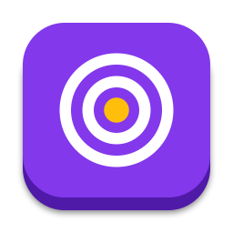
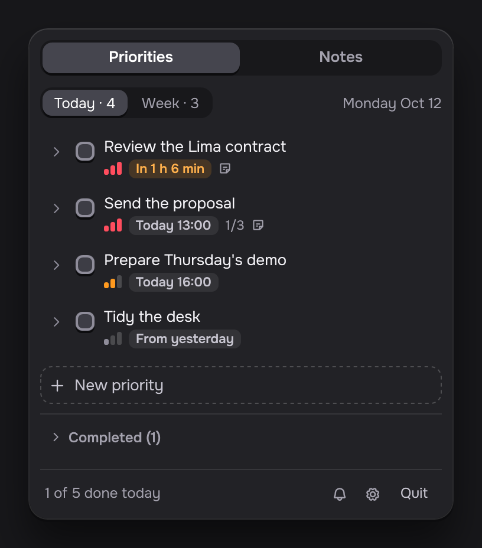
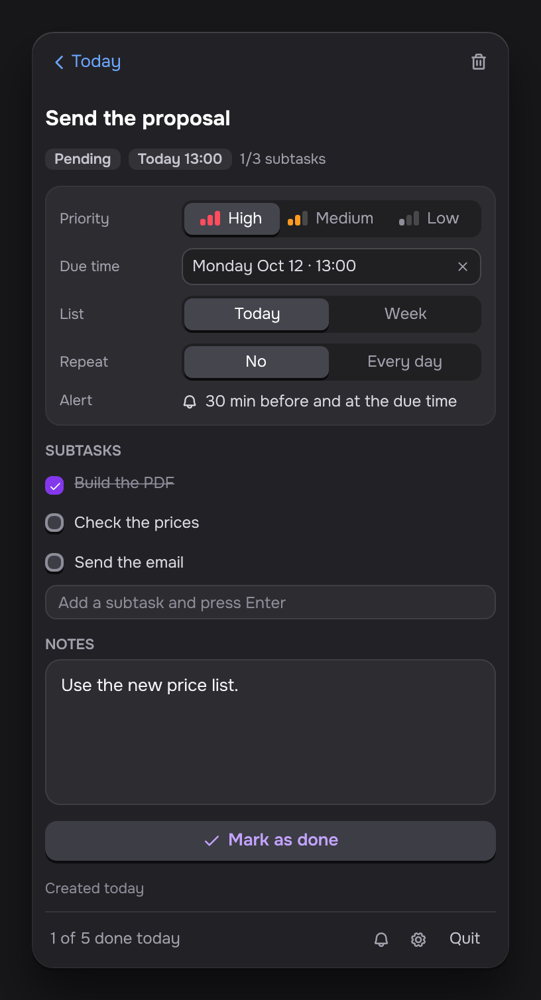
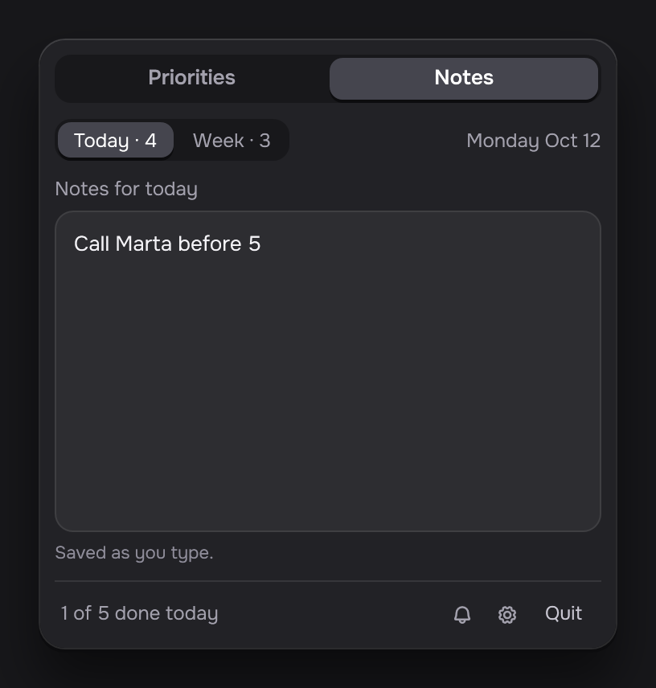
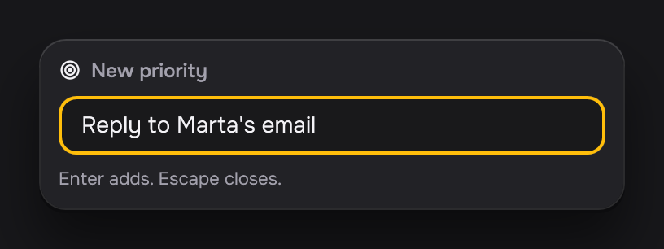
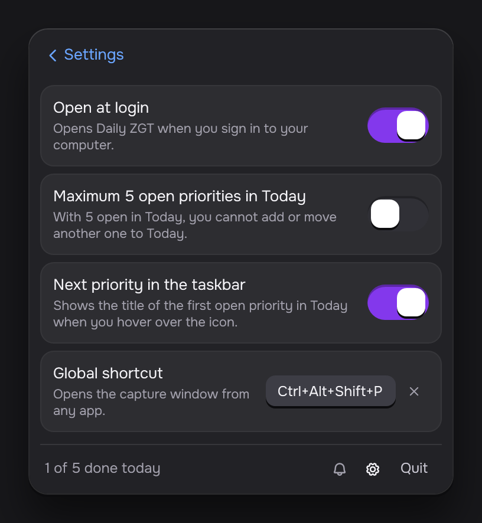
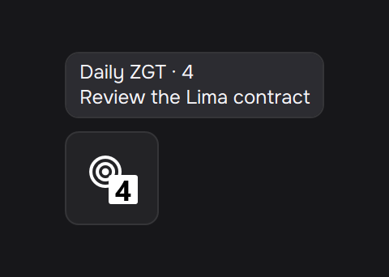

# Daily ZGT

Daily ZGT keeps the priorities and the notes of the day and the week. It lives in the system tray on Windows and in the menu bar on macOS. A click on its icon opens a small dark panel.

The Windows app speaks English, Spanish and Portuguese, and it follows the Windows display language. The macOS app is Spanish only for now.



The images in this README come from the Windows app. Both apps use the same Tecla design.

## Features

- The tray icon shows the count of open priorities in Today. A setting adds the title of the next open priority.
- The panel has two tabs, Priorities and Notes. Each tab has two scopes, Today and Week.
- A priority has a level (high, medium or low), an optional due date and time, subtasks, and a note.
- The checkbox asks before it marks a priority done. Then an Undo button shows for 5 seconds.
- The section Completed shows the priorities that you marked done in the last 24 hours. History shows the older ones.
- A setting limits Today to 5 open priorities.
- A priority can repeat each day.
- The chip "From yesterday" shows on an open priority that stays in Today after the day changes.
- An alert comes 30 minutes before the due time and at the due time. Its action "Snooze 15 min" sets a new alert in 15 minutes.
- A global shortcut opens a capture window from any app. It is Ctrl+Alt+Shift+P on Windows and Control+Option+Command+P on macOS.
- A setting starts the app when you sign in.
- All data stays in one SQLite file on your computer. The app has no account and it does not use the network.

## Screens

### The detail view of a priority

The level, the due time, the list, the repeat, the alert, the subtasks and the note.



### Notes

One note for each day and one note for each week.



### The capture window

Press the global shortcut, type a title and press Enter. The priority goes to Today.



### Settings

Open at login, the limit of 5 open priorities in Today, the title of the next priority, and the global shortcut.



### The tray icon

The badge is the count of open priorities in Today. The tooltip shows the count and the title of the next priority. On macOS the menu bar item shows the same two values.



## Download

### Windows

You need 64-bit Windows 10 (build 19041) or later. You do not need to install .NET.

1. Open the [Releases page](https://github.com/giancarlosisasi/daily-zgt/releases).
2. Find the newest release whose tag starts with `windows-v`. The first release is [windows-v0.1.0](https://github.com/giancarlosisasi/daily-zgt/releases/tag/windows-v0.1.0).
3. Download `DailyZGT.Windows-win-Setup.exe` from its assets and run it.

The installer is for your user only and needs no admin rights. When it finishes, Daily ZGT opens and a `Daily ZGT` shortcut appears in the Start menu.

The installer is not code-signed yet. Windows SmartScreen shows "Windows protected your PC". Click **More info**, then **Run anyway**.

To uninstall, open Settings, Apps, Installed apps, find Daily ZGT and choose Uninstall. The uninstaller removes the app, the Start menu shortcut and the login entry. It keeps your data. The file `%LOCALAPPDATA%\DailyZGT\daily-zgt.sqlite` stays on your computer. Delete its folder if you want the data gone.

The app does not check for updates yet. To update, uninstall it and run the newer `Setup.exe`. Your data stays.

### macOS

There is no download for macOS yet. Build the app from source. See the next section.

## Build from source

The repository has a `justfile`. Install [`just`](https://github.com/casey/just) and run `just` to list every task.

### Windows app

You need Windows 10 (build 19041) or later, the .NET 10 SDK and Python 3.

```bash
just win-check
just win-run
```

`just win-check` checks the design tokens, builds, and runs the tests. `just win-run` starts the app with the panel open. `just win-pack` packs the installer. See [`apps/windows/README.md`](apps/windows/README.md) for the flags, the environment variables and the release steps.

### macOS app

You need macOS 14 or later, Xcode 26 and XcodeGen (`brew install xcodegen`).

```bash
just mac-test
just mac-install
open /Applications/DailyZGT.app
```

`just mac-test` generates the Xcode project and runs the tests. `just mac-install` builds the Release configuration and copies the app to `/Applications/DailyZGT.app`. If the app runs from `/Applications`, quit it before you run `just mac-install`. The app has no Dock icon. Click the target icon in the menu bar to open the panel.

### Website

```bash
just web-install
just web-dev
```

### README images

`just readme-shots` rebuilds the images in `assets/readme` from the Windows app. It draws each screen offscreen in English. It does not capture your screen.

## Repository layout

The repository is a monorepo. Each app uses its own native build tool.

| Folder | Content |
| --- | --- |
| `apps/macos/` | The macOS app (Swift, SwiftUI, GRDB, XcodeGen) |
| `apps/windows/` | The Windows app (C# on .NET 10, WPF, Microsoft.Data.Sqlite) |
| `apps/website/` | The docs and landing site (Rspress), in English, Spanish and Portuguese |
| `packages/design-tokens/` | `tecla.json`, the one source of the colors, sizes and motion of both apps |

Both apps use the same SQLite schema.

## License

The code uses the [MIT License](LICENSE).
