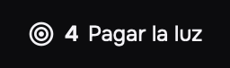

# Daily ZGT

Daily ZGT is a macOS menu bar app that keeps the priorities and the notes of the day and the week.


## Features

The text in the app is Spanish. This list shows each label in quotes, with its English meaning in parentheses.

- The menu bar item shows the count of open priorities of the list "Hoy" (today). It can also show the title of the next open priority.
- The panel has two tabs: "Prioridades" (priorities) and "Notas" (notes). Each tab has two scopes: "Hoy" and "Semana" (this week).
- A priority has a level (high, medium or low), an optional due date and time, subtasks and a note.
- The checkbox asks before it marks a priority done. Then the button "Deshacer" (undo) shows for 5 seconds. Click it to bring the priority back.
- The section "Hechas" (done) shows the priorities that you marked done in the last 24 hours. "Historial" (history) shows the older ones.
- A setting limits "Hoy" to 5 open priorities.
- A priority can repeat each day.
- The chip "De ayer" (from yesterday) shows on an open priority that stays in "Hoy" after the day changes.
- An alert with sound comes 30 minutes before the due time and at the due time. Its action "Posponer 15 min" (snooze 15 minutes) sets a new alert in 15 minutes.
- The shortcut ⌃⌥⌘P opens a capture window from any app.
- A setting starts the app when you log in.
- The app keeps all data in one SQLite file on your Mac. It has no account and it does not use the network.

## Screens

### The menu bar item

The count of open priorities of Hoy and the title of the next one.



### The detail view of a priority

The level, the due date, the list, the repeat, the subtasks and the note.


### Notes

One note for each day and one note for each week.


### The capture window

Press ⌃⌥⌘P, type the title and press Enter.


### Settings

Start at login, the limit of 5, the title in the menu bar and the global shortcut.


## Install

You need macOS 14 or later, Xcode 26 and XcodeGen (`brew install xcodegen`).

```bash
./apps/macos/scripts/install.sh
open /Applications/DailyZGT.app
```

The script generates the Xcode project, builds the Release configuration and copies the app to `/Applications/DailyZGT.app`. If the app runs from `/Applications`, quit it before you run the script.

The app has no Dock icon. Click the target icon in the menu bar to open the panel.

## Develop

The macOS app lives in `apps/macos/`. Run the commands below from that folder.

Generate the Xcode project. Run this command again after each change to `project.yml`.

```bash
cd apps/macos
xcodegen generate
```

Build the app.

```bash
xcodebuild -project DailyZGT.xcodeproj -scheme DailyZGT -destination 'platform=macOS' -derivedDataPath build build
```

Run the tests.

```bash
xcodebuild -project DailyZGT.xcodeproj -scheme DailyZGT -destination 'platform=macOS' -derivedDataPath build test
```

The folder `apps/website/` holds the site: a landing page and the Guide, in English, Spanish and Portuguese.

```bash
cd apps/website && pnpm install && pnpm dev
```

## Repository layout

The repository is a monorepo. Each app uses its own native build tool.

| Folder | Content |
| --- | --- |
| `apps/macos/` | The macOS app (Swift, SwiftUI, XcodeGen) |
| `apps/windows/` | The Windows app (C#). Not built yet. |
| `apps/website/` | The site (Rspress) |
| `packages/design-tokens/` | `tecla.json`, the one source of the colors, sizes and motion of all apps |

The `justfile` at the root runs the common tasks. Run `just` to list them, for example `just mac-test` or `just web-dev`.

## Stack

Swift 6, SwiftUI, GRDB (SQLite), KeyboardShortcuts and XcodeGen. The site uses Rspress.

## License

The code uses the [MIT License](LICENSE).
